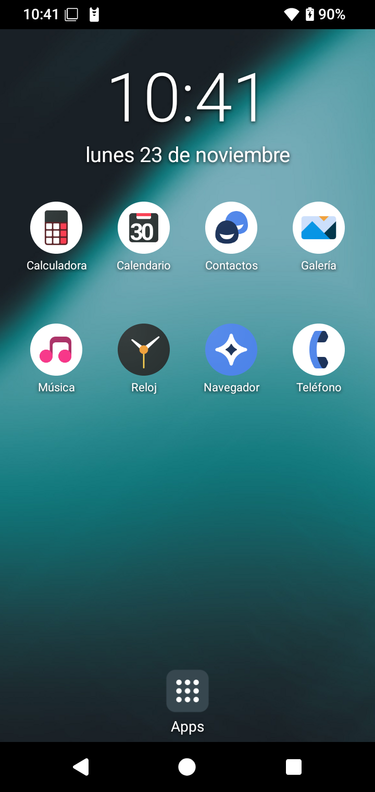
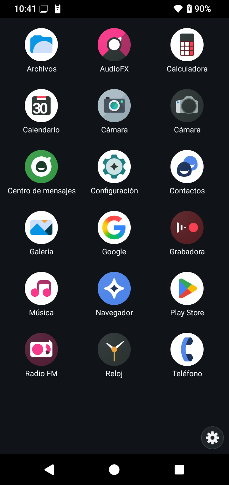
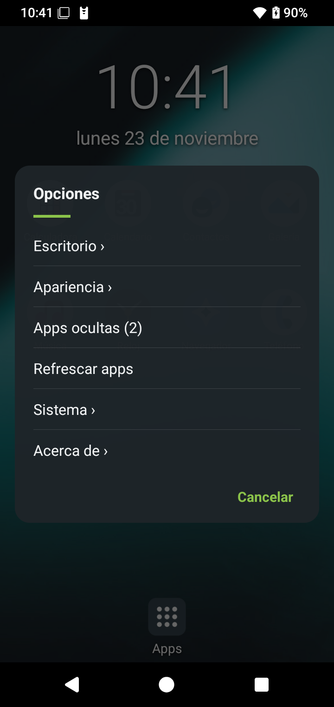

<h1 align="center">YerbaLauncher</h1>

<h2 align="center"><a href="https://github.com/matcarfer/YerbaLauncher/releases/download/v1.6.0/YerbaLauncher-1.6.0.apk">⬇ Download APK</a></h2>

  <a href="README.md">Español</a> · <b>English</b>  
Simple, lightweight launcher for phones, tablets and TV boxes. 
No internet, no ads and nothing in the background. 
<b>Compatible with Android 2.3 to 15.</b>

  
  
  

**How to use:** install it, press Home and choose **YerbaLauncher → Always**.

  <a href="https://cafecito.app/matcarfer">☕ Cafecito</a> · <a href="https://ko-fi.com/matcarfer">☕ Ko-fi</a> · <a href="https://www.patreon.com/matcarfer">❤ Patreon</a> 
  <a href="https://github.com/matcarfer/library/blob/main/README.en.md">📚 Software library</a>

---

Free, closed source. Do not redistribute: share this link. No warranty. <a href="LICENSE.en">License</a> · <a href="PRIVACY.md">Privacy</a> · <a href="https://www.virustotal.com/gui/file/8f568df59aab5126c9eb1deaefb6d62548eb2df4bb91baa4ac1934f1cc6cb92a">VirusTotal</a>
