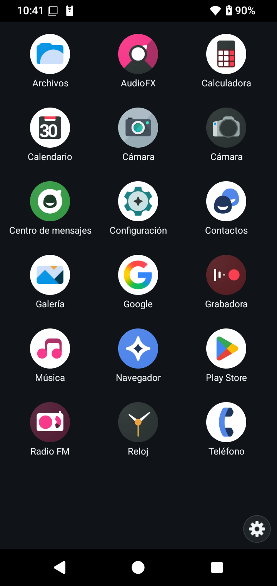

<h1 align="center">YerbaLauncher</h1>

  <b>Español</b> · <a href="README.en.md">English</a>  
  Launcher simple y liviano para celulares, tablets y cajas de TV, viejos y nuevos. 
Sin internet, sin publicidad y sin nada en segundo plano. Android 2.3+.

<a href="https://github.com/matcarfer/YerbaLauncher/releases/download/v1.6.0/YerbaLauncher-1.6.0.apk"><b>⬇ Descargar YerbaLauncher 1.6.0</b></a>

  
  
  

**Cómo se usa:** instalala, apretá Inicio y elegí **YerbaLauncher → Siempre**.

  <a href="https://cafecito.app/matcarfer">☕ Cafecito</a> · <a href="https://ko-fi.com/matcarfer">☕ Ko-fi</a> · <a href="https://www.patreon.com/matcarfer">❤ Patreon</a> 
  <a href="https://github.com/matcarfer/library">📚 Biblioteca de software</a>

---

Gratis, de código cerrado. Podés usarla libremente; no la redistribuyas, compartí este link. Sin garantía. <a href="LICENSE">Licencia</a> · <a href="PRIVACY.es.md">Privacidad</a> · <a href="https://www.virustotal.com/gui/file/8f568df59aab5126c9eb1deaefb6d62548eb2df4bb91baa4ac1934f1cc6cb92a">VirusTotal</a>
