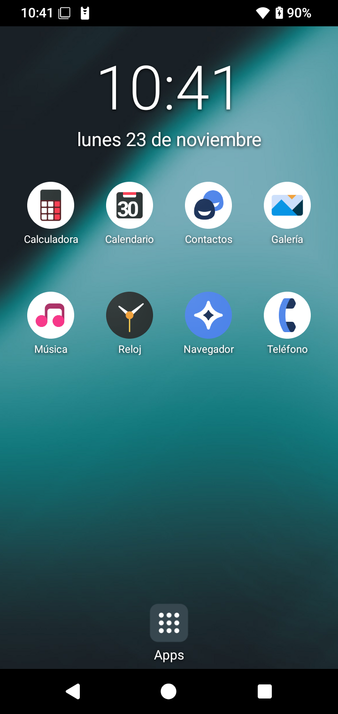
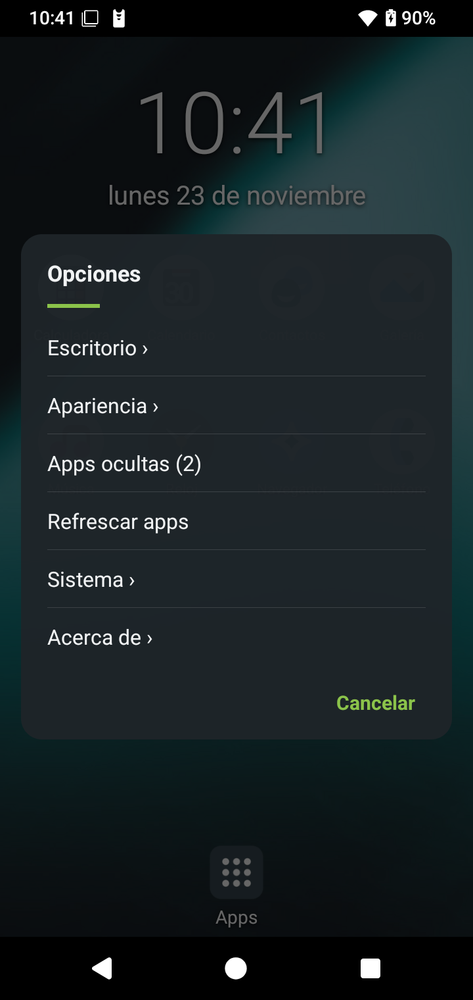

<h1 align="center">YerbaLauncher</h1>

<h2 align="center"><a href="https://github.com/matcarfer/YerbaLauncher/releases/download/v1.6.1/YerbaLauncher-1.6.1.apk">⬇ Descargar APK</a></h2>

  <b>Español</b> · <a href="README.en.md">English</a>  
Cambiá el launcher de tablets y celulares viejos por uno simple y súper liviano. 
Sin internet, sin publicidad y sin nada en segundo plano. 
<b>Compatible con Android 2.3 a 16.</b>

  
  
  

**Cómo se usa:** instalala, apretá Inicio y elegí **YerbaLauncher → Siempre**.

  <a href="https://cafecito.app/matcarfer">☕ Cafecito</a> · <a href="https://ko-fi.com/matcarfer">☕ Ko-fi</a> · <a href="https://www.patreon.com/matcarfer">❤ Patreon</a> 
  <a href="https://github.com/matcarfer/biblioteca">📚 Biblioteca de software</a>

---

Gratis, de código cerrado. No redistribuir: compartí este link. Sin garantía. <a href="LICENSE">Licencia</a> · <a href="PRIVACY.es.md">Privacidad</a> · <a href="https://www.virustotal.com/gui/file/b5c0213464f7317e496326207b88c223f3d81706b8efc32bdb6a6085fed85389">VirusTotal</a>
